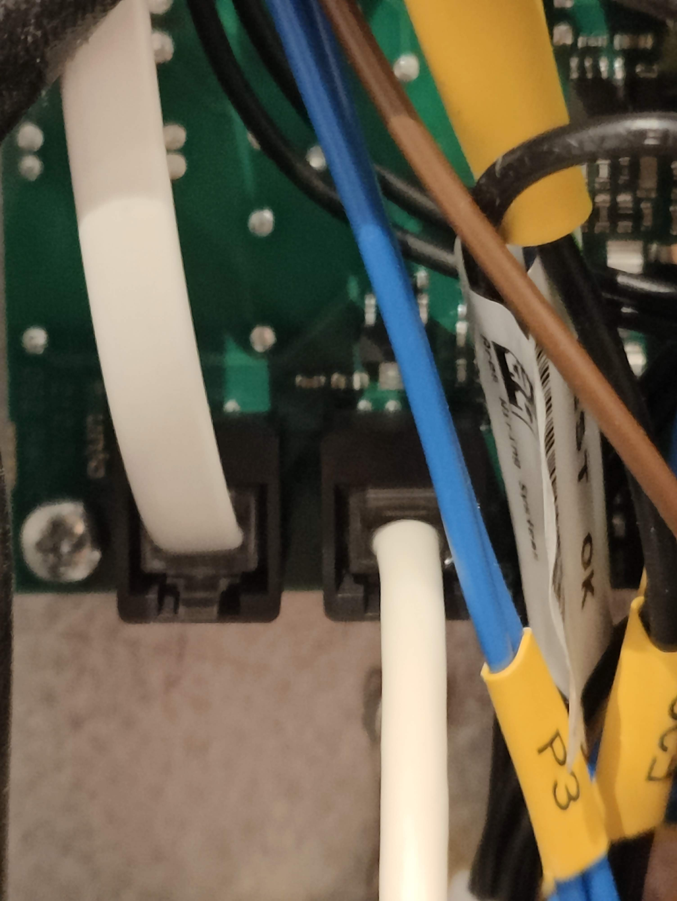
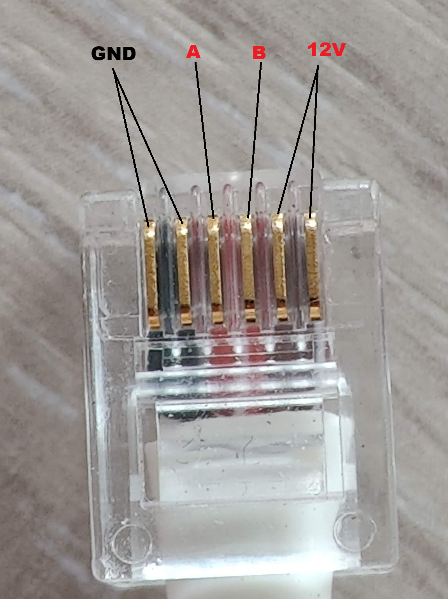
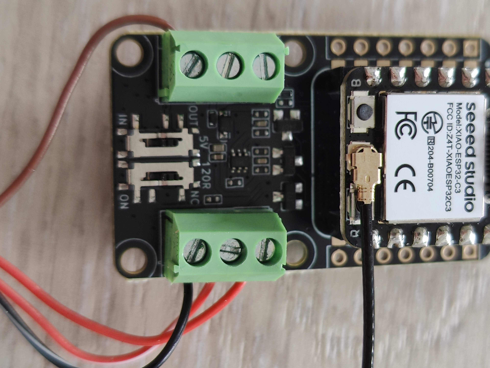
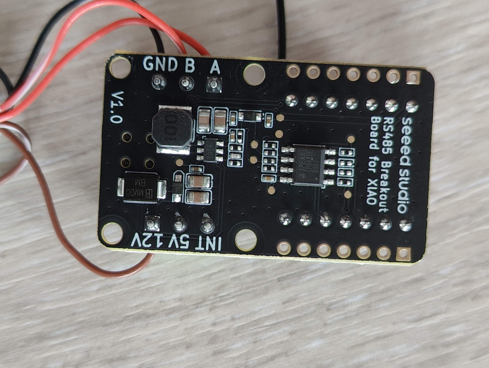

# Overview
The `XIAO-ESP32-C3` and `RS485 Breakout Board for Seeed Studio-XIAO` is easy to assemble and results in a small package. Buy the pre soldered header version to avoid soldering. 

## Links
[`XIAO-ESP32-C3` - Seeedstudio](https://www.seeedstudio.com/Seeed-XIAO-ESP32C3-p-5431.html) 
[`RS485 Breakout Board for Seeed Studio-XIAO` - Seeedstudio](https://www.seeedstudio.com/RS485-Breakout-Board-for-XIAO-p-6306.html)

## C(X)60

| C(X)60 connection header | RJ12 pinout |
|---|---|
|  |  |

Click images to view full size.

## XIAO
| Front | Back |
|---|---|
|  |  |

Click images to view full size.

### DIP switches
- The DIP switch for IN/OUT needs to be configured based on your needs. Leave it in OUT if unsure. 
- The DIP switch for the 120Ω termination resistor can be left in NC.

## Pins
The board uses the same XIAO pins whichever XIAO is on it, so `example.yaml` works on any of them with
just the board name changed (e.g. `seeed_xiao_esp32c6`).

| XIAO pin | Function |
|---|---|
| D4 | TX, to the transceiver |
| D5 | RX, from the transceiver |
| D2 | DE/RE direction |

V1.2 of the board ships with hardware direction control and ignores D2, V1.1 and earlier switch direction on
D2. Leaving `flexit_tx_enable_pin: D2` in place works for both.

## Config
See the normal config in the README. 